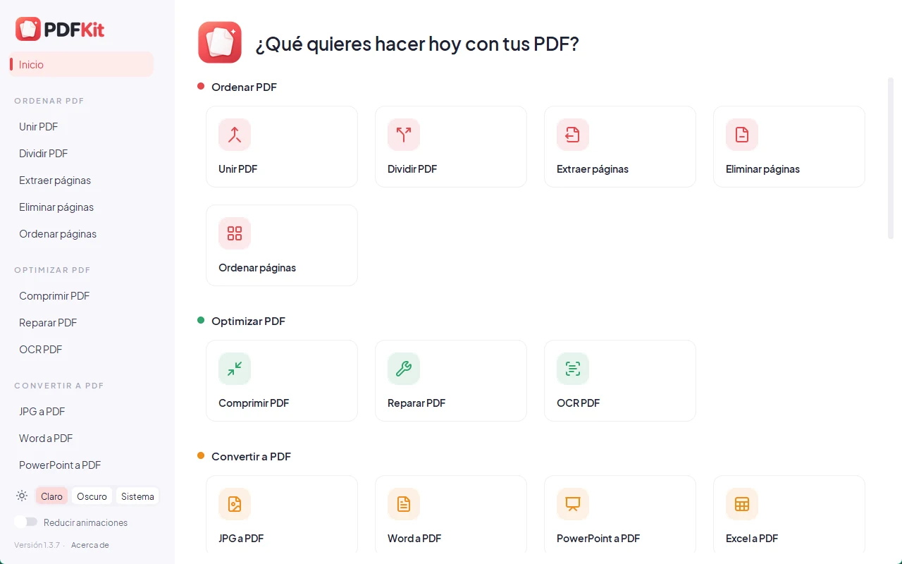
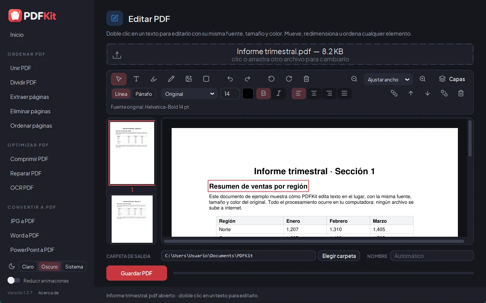

<p align="center">
  
</p>

<p align="center">
  <b>Todas tus herramientas PDF, sin internet.</b><br>
  <i>All your PDF tools, offline.</i><br>
  <sub>Antes PDFKit · Formerly PDFKit</sub>
</p>

<p align="center">
  <a href="https://github.com/Blureckzhyto/pliegue/releases/latest"><b>⬇ Descargar para Windows · Download for Windows</b></a>
  ·
  <a href="https://blureckzhyto.github.io/pliegue/">Página · Website</a>
  ·
  <a href="CHANGELOG.md">Cambios · Changelog</a>
</p>

<p align="center">
  
  
</p>

**[Español](#español) · [English](#english)**

---

## Español

Pliegue (antes PDFKit) es una caja de herramientas de PDF e imágenes para Windows, al estilo de iLovePDF,
que funciona **completamente sin internet**: tus archivos nunca salen de tu computadora.
Es gratis, de código abierto y sin anuncios.

### Funciones

- **Ordenar PDF:** unir, dividir (por rangos, cada N páginas o tamaño máximo), extraer,
  eliminar y ordenar páginas.
- **Optimizar PDF:** comprimir (3 niveles), reparar archivos dañados, OCR (agrega texto
  buscable a PDFs escaneados, en español e inglés).
- **Convertir a PDF:** JPG, Word, PowerPoint, Excel y HTML.
- **Convertir desde PDF:** JPG, Word, PowerPoint, Excel y PDF/A.
- **Editar PDF:** editor real (doble clic en un texto para cambiarlo con su misma fuente),
  rotar, números de página, marca de agua, recortar y formularios.
- **Editar y firmar:** firmar, proteger y desproteger con contraseña, censurar (borra el
  contenido de verdad) y comparar dos PDFs.
- **Imágenes:** convertir entre PNG, JPG, WEBP, BMP, TIFF y HEIC, y comprimir.
- Modo claro y oscuro.

### Descarga e instalación

1. Descarga el instalador de la versión más reciente en **[Releases](https://github.com/Blureckzhyto/pliegue/releases/latest)**.
2. Ábrelo. Como el instalador no tiene firma digital de pago, Windows puede mostrar
   **«Windows protegió su PC»**: haz clic en **Más información** → **Ejecutar de todas formas**.
   Puedes comprobar el archivo con el SHA-256 publicado en cada versión.
3. Para desinstalar: *Configuración → Aplicaciones → Pliegue → Desinstalar*.

**Requisitos:** Windows 10 u 11 de 64 bits. Word, PowerPoint o LibreOffice son opcionales
(mejoran «Word a PDF» y «PowerPoint a PDF»).

### Privacidad

Todo el procesamiento ocurre en tu computadora. Pliegue no tiene telemetría, estadísticas ni
anuncios, y no se conecta a internet. La única excepción es opcional y la decides tú: en
«HTML a PDF» puedes escribir la dirección de una página web (o convertir un HTML que enlace
imágenes en línea), y entonces se descarga esa página para convertirla.

### Compilar desde el código

```powershell
git clone https://github.com/Blureckzhyto/pliegue.git
cd pliegue
py -3.11 -m pip install -r requirements.txt
py -3.11 tools\fetch_assets.py
build.bat
```

Detalles, pruebas y lista de verificación de cada versión: [BUILDING.md](BUILDING.md).

### Licencia

Pliegue es software libre bajo la **[GNU Affero General Public License v3.0](LICENSE)**
(© 2026 Blureckzhyto). Incluye componentes de terceros con sus propias licencias (PyMuPDF,
Poppler, Tesseract, WeasyPrint, fuentes libres, iconos Lucide y otros): ver
[THIRD_PARTY_LICENSES.md](THIRD_PARTY_LICENSES.md).

---

## English

Pliegue (formerly PDFKit) is an iLovePDF-style PDF and image toolbox for Windows that works **completely
offline**: your files never leave your computer. It is free, open source and ad-free.
The interface is in Spanish.

### Features

- **Organize:** merge, split (by ranges, every N pages or max size), extract, delete and
  reorder pages.
- **Optimize:** compress (3 levels), repair damaged files, OCR (adds searchable text to
  scanned PDFs, Spanish and English).
- **Convert to PDF:** JPG, Word, PowerPoint, Excel and HTML.
- **Convert from PDF:** JPG, Word, PowerPoint, Excel and PDF/A.
- **Edit:** a real editor (double-click any text to change it with its own font), rotate,
  page numbers, watermark, crop and forms.
- **Edit & sign:** sign, password protect/unprotect, redact (truly removes the content) and
  compare two PDFs.
- **Images:** convert between PNG, JPG, WEBP, BMP, TIFF and HEIC, and compress.
- Light and dark mode.

### Download and install

1. Download the installer for the latest version from **[Releases](https://github.com/Blureckzhyto/pliegue/releases/latest)**.
2. Run it. Because the installer is not code-signed, Windows may show
   **"Windows protected your PC"**: click **More info** → **Run anyway**. You can verify the
   file with the SHA-256 published with each release.
3. To uninstall: *Settings → Apps → Pliegue → Uninstall*.

**Requirements:** Windows 10 or 11, 64-bit. Word, PowerPoint or LibreOffice are optional
(they improve "Word to PDF" and "PowerPoint to PDF").

### Privacy

All processing happens on your computer. Pliegue has no telemetry, analytics or ads and does
not connect to the internet. The only exception is optional and yours to choose: in "HTML a
PDF" you can type a web address (or convert an HTML file that links online images), and that
page is then downloaded to convert it.

### Build from source

See the commands above and [BUILDING.md](BUILDING.md).

### License

Pliegue is free software under the **[GNU Affero General Public License v3.0](LICENSE)**
(© 2026 Blureckzhyto). It bundles third-party components under their own licenses
(PyMuPDF, Poppler, Tesseract, WeasyPrint, free fonts, Lucide icons and more): see
[THIRD_PARTY_LICENSES.md](THIRD_PARTY_LICENSES.md).
